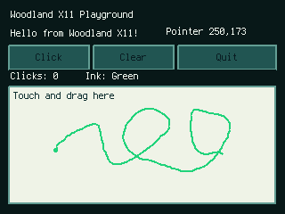

# ESP32 CYD support — EXPERIMENTAL

Woodland X11 has an experimental port for the **ESP32-2432S028** Cheap Yellow Display (the
Arduino-ESP32 variant is named `jczn_2432s028r`). This port is not a general claim for every
board sold as a CYD.

| Component | Tested configuration |
|---|---|
| MCU | Classic ESP32-D0WD-V3, revision 3.1; no PSRAM |
| Flash | 4 MB; Arduino `default` partition, 1.2 MB application slot |
| Display | ST7789, 320×240 RGB565 landscape; LovyanGFX GRAM-backed drawing |
| Touch | XPT2046 over SPI; touch is sent as the X11 core pointer |
| Network | Wi-Fi TCP display `:0`, port 6000, required MIT-MAGIC-COOKIE-1 |
| Input extension | XTEST 2.2 pointer input; keyboard input is not implemented |

The display is the root drawable. Window and pixmap resources still use internal heap; depth-1
pixmaps use packed one-bit storage. There is no full-screen RGB565 framebuffer in ESP32 RAM.

## Build

The checked build profile is Arduino-ESP32 3.3.12, the `jczn_2432s028r` board definition, and
LovyanGFX 1.2.36. Install those exact versions, then run from the repository root:

```sh
arduino-cli core install esp32:esp32@3.3.12
arduino-cli lib install LovyanGFX@1.2.36
esp32/cyd/build_cyd.sh
```

The script validates the installed versions and applies the profile in one place:

- 16 compiled and active X11 client slots; one connection-refusal slot.
- 256 global resource entries and 48 resources per client.
- 80 KiB shared X11 allocation budget, 12 KiB per-client output queue, and 4 KiB reply scratch.
- 4 KiB atom-name pool and 2,000-byte generated diagnostic property, sized for the reply scratch.
- `XR_MAX_POLY=512`, matching the tested CYD build.

The per-client quota is 48: it is the tested configuration that framed a 180×110 window using
46 resources. The later quota-128 image did not make GTK2's pixmap allocation succeed, so the
higher limit is not adopted. The application image and build-size summary are written to
`build/cyd/`; the script does not upload or flash anything.

## Flash an application update

The board's existing bootloader and partition table must match the checked profile. For an
app-only update, replace `PORT` with the CYD's serial device and run:

```sh
esptool --chip esp32 --port PORT write-flash 0x10000 build/cyd/CYDNetX11.ino.bin
```

This writes only the application partition. Do not use an erase-all option. The profile uses the
4 MB default partition table; the app must fit its 1.2 MB slot. Confirm the image hash and target
before any device write.

## Provision Wi-Fi and X11 authentication

At the CYD serial console, enter these commands, substituting the local network values:

```text
SSID your-network-name
PASS your-network-password
COOKIE NEW
START
```

`COOKIE NEW` creates and stores a random 16-byte cookie in Preferences/NVS. To retrieve it when
creating an Xauthority file, explicitly enter `AUTH`; the cookie is printed only in response to
that command. Keep that serial output private. The server requires this cookie and has no
unauthenticated fallback. X11 traffic is not encrypted.

Store the 32 hexadecimal cookie digits in a mode-0600 file, then create an Xauthority entry for
the numeric IPv4 address the client will use. The helper never prints the cookie and refuses to
replace an existing authority file by default:

```sh
umask 077
python3 - <<'PY'
import getpass, os
from pathlib import Path
p = Path('/tmp/cyd-cookie')
s = getpass.getpass('Cookie from the explicit AUTH response: ').strip()
if len(s) != 32:
    raise SystemExit('expected 32 hex digits')
bytes.fromhex(s)
p.write_text(s + '\n', encoding='ascii')
os.chmod(p, 0o600)
PY

python3 esp32/cyd/cyd_xauthority.py \
  --host 192.0.2.10 --display 0 \
  --cookie-file /tmp/cyd-cookie --output /tmp/cyd.Xauthority
```

Replace `192.0.2.10` with the CYD's current LAN address. Use the same numeric IPv4 in
`DISPLAY`; this ensures the Xauthority address-family record matches the TCP connection. Do not
put the cookie directly in command arguments or shell history. Rotating the cookie invalidates
new connections made with the old value; already-authenticated clients remain connected until
they close or the server restarts.

## Connect from Linux or macOS

```sh
export DISPLAY=192.0.2.10:0
export XAUTHORITY=/tmp/cyd.Xauthority
xdpyinfo
```

No window manager is required. To try a small terminal window:

```sh
xterm -geometry 40x14+0+0
```

`htop` can be displayed inside xterm with `xterm -geometry 40x14+0+0 -e htop`, but it is not
interactive: the server currently has no keyboard input. Touch supplies pointer input only.

## Woodland X11 Playground

Build the core-Xlib sample on the Linux/macOS client machine:

```sh
tools/client_matrix/build_woodland_playground.sh
DISPLAY="$DISPLAY" XAUTHORITY="$XAUTHORITY" build/woodland_x11_playground
```

It opens one 320×240 window with Click, Clear, and Quit, a counter, pointer coordinates, and a
touch-drawing canvas. Clear erases strokes but does not reset the click count. The complete
interface and stroke history are reconstructed on Expose. A screenshot captured from the CYD is
shown below.



## Memory limits and known issues

- Sixteen client slots are configured; this is an available slot count, not a promise that 16
  graphics-heavy applications can run. Four active clients are the recommended operating load;
  eight passed the recorded graphics stress test.
- Internal RAM is limited and there is no PSRAM. Large pixmaps and resource-heavy applications
  can still receive `BadAlloc`. The 48-resource per-client quota is intentionally retained.
- LCD GRAM readback is much slower than RAM framebuffer reads; large `GetImage`, `CopyArea`, or
  read-modify-write operations can be slow.
- Window managers are **not currently supported reliably**. Reparenting and subsequent Expose
  rendering have produced incorrect visible pixels on this hardware.
- GTK2/GTK3/Qt5/Qt6 compatibility is not claimed. GTK2's first pixmap allocation still failed
  with quota 128.
- Keyboard input, XKB, RANDR, and XRender are not supported by this port.

## Host smoke test

The small Xlib application can also be checked without hardware using Xvfb and the Woodland host
server. See [`tools/client_matrix/WOODLAND_PLAYGROUND.md`](../../tools/client_matrix/WOODLAND_PLAYGROUND.md)
for the build and smoke-test commands.
